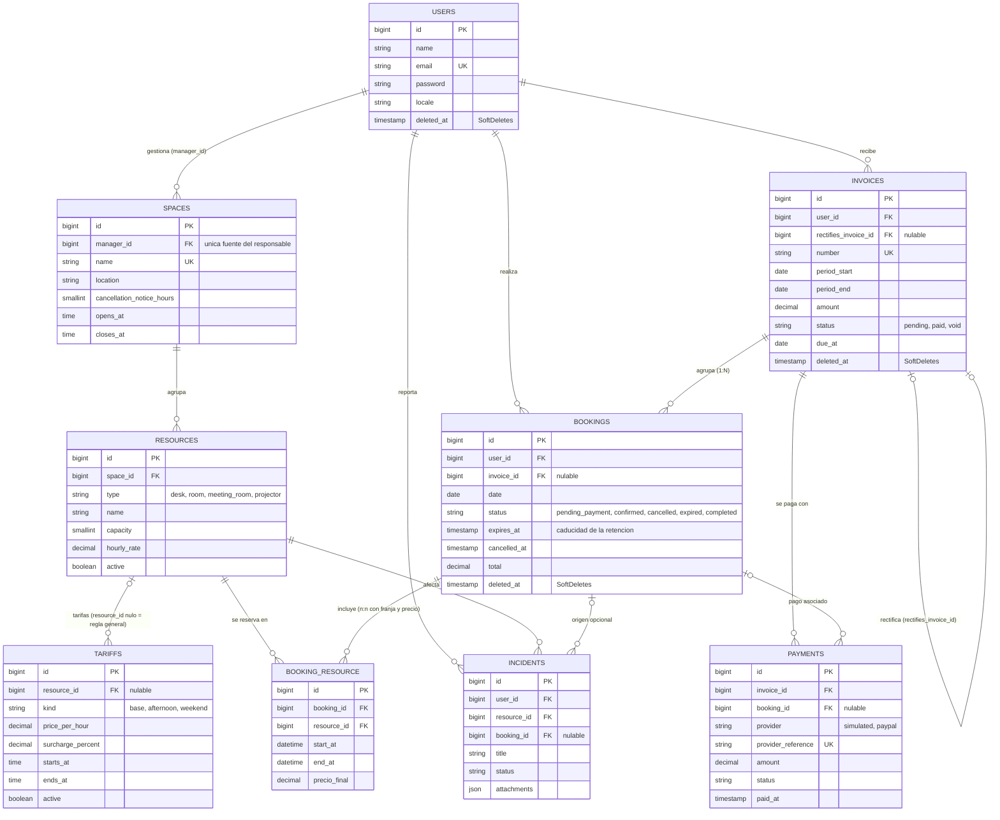

# WorkSpace · Modelo de datos

Diagrama entidad-relación de la base de datos. Ocho modelos de dominio
(`User`, `Space`, `Resource`, `Tariff`, `Invoice`, `Booking`, `Payment`, `Incident`)
más la pivote con datos `booking_resource` (modelo pivote propio `BookingResource`,
que no cuenta como modelo de API).

## Justificación de las entidades

- **User.** Representa a cualquier persona con cuenta: miembros, recepción, responsables,
  contables y administradores. Es una sola entidad porque todos se autentican igual y una misma
  persona puede ser responsable de un espacio y, a la vez, reservar. El rol no es una columna ni
  una tabla por tipo de usuario: se asigna con laravel-permission. Guarda `locale` (idioma) y usa
  borrado lógico para no perder el histórico de sus reservas y facturas.
- **Space.** Una zona del coworking que agrupa recursos. Es la única fuente del responsable
  (`manager_id`): si el responsable estuviera también en `Resource` habría dos datos que
  sincronizar. Guarda las reglas comunes de sus recursos: horario de apertura y antelación mínima
  para cancelar.
- **Resource.** Lo que se reserva: puesto, sala, sala de reuniones o proyector. Es una sola tabla
  con `type` porque todos se reservan igual (por franja y precio por hora) y solo cambian la
  capacidad y la tarifa. `hourly_rate` es la tarifa base. `active` permite retirar un recurso sin
  perder el histórico.
- **Tariff.** Reglas de precio que modifican la tarifa base: recargo de tarde o de fin de semana,
  generales (sin recurso) o de un recurso concreto. Está separada de `Resource` para poder tener
  varias reglas y vigencias por recurso. Un cambio de tarifa no altera reservas ya facturadas,
  porque el precio de cada franja queda guardado en `precio_final`.
- **Booking.** La operación de un usuario: agrupa uno o varios recursos y es la unidad que se
  cancela, factura y paga. Guarda estado, total y `expires_at` (caducidad de la retención mientras
  espera el pago). La franja no va aquí sino en la pivote, porque cada recurso de una misma reserva
  tiene su propia franja y precio. Usa borrado lógico para conservar el histórico.
- **booking_resource (pivote).** Resuelve la relación n:n entre reserva y recurso y guarda los
  datos de cada recurso reservado: `start_at`, `end_at` y `precio_final`. Es la tabla sobre la que
  se comprueban los solapes (índice por recurso y franja). Tiene modelo propio, `BookingResource`,
  para manejar esas columnas desde el código. No usa SoftDeletes.
- **Invoice.** El documento de cobro: agrupa reservas de un mismo usuario en un periodo
  (Invoice 1:N Booking). Tiene número único, vencimiento y estado (pendiente, pagada, anulada). Es
  una entidad propia, y no un campo de `Booking`, porque agrupa varias reservas y debe sobrevivir a
  ellas. No se borra: se anula y se rectifica con otra factura mediante `rectifies_invoice_id`.
- **Payment.** Cada cobro de una factura, simulado o por PayPal: importe, estado y referencia
  externa única. Está separado de `Invoice` porque una factura puede tener varios cobros (por
  ejemplo, uno fallido y otro completado) y porque guarda datos del proveedor externo. Apunta,
  opcionalmente, a la reserva que se pagó.
- **Incident.** El aviso de un usuario sobre un recurso (por ejemplo, un proyector que no
  enciende), con estado y adjuntos, y ligado de forma opcional a la reserva en la que ocurrió. Es
  una entidad propia porque tiene su propio ciclo de vida (abierta, en curso, resuelta, cerrada) y
  lo gestiona el responsable del espacio, no quien reserva.

## Relaciones del modelo

Todas se recorren en los tests (`DatabaseSchemaTest` y `RelationshipsTest`).

| Desde | Relación | Tipo | Hasta |
|---|---|---|---|
| User | `managedSpaces` | 1:n | Space |
| User | `bookings` | 1:n | Booking |
| User | `invoices` | 1:n | Invoice |
| User | `incidents` | 1:n | Incident |
| Space | `manager` | n:1 | User |
| Space | `resources` | 1:n | Resource |
| Resource | `space` | n:1 | Space |
| Resource | `manager` | n:1 (a través de Space) | User |
| Resource | `tariffs` | 1:n | Tariff |
| Resource | `incidents` | 1:n | Incident |
| Resource | `bookings` | n:n (pivote con datos) | Booking |
| Resource | `slots` | 1:n | BookingResource |
| Booking | `resources` | n:n (pivote con datos) | Resource |
| Booking | `slots` | 1:n | BookingResource |
| Booking | `invoice` | n:1 | Invoice |
| Booking | `payments` | 1:n | Payment |
| Booking | `incidents` | 1:n | Incident |
| Invoice | `bookings` | 1:n | Booking |
| Invoice | `payments` | 1:n | Payment |
| Invoice | `rectifies` / `rectifiedBy` | 1:1 (consigo misma) | Invoice |
| Tariff, Payment, Incident, BookingResource | las relaciones inversas (`resource`, `invoice`, `booking`, `user`) | n:1 | su entidad padre |

## Decisiones de diseño

- **Responsable de un recurso**: se deriva siempre de `spaces.manager_id`
  (`Resource::manager()` es una relación `hasOneThrough`). `resources` no guarda responsable.
- **Invoice 1:N Booking**: `bookings.invoice_id` es nulable. Una reserva solo cambia de
  factura mientras la suya siga pendiente o cuando se anula y pasa a la rectificativa.
- **Facturas históricas**: una factura emitida no se borra. Se anula (`status = void`) y,
  si procede, otra la rectifica (`rectifies_invoice_id`). Todas las claves hacia `invoices`
  son `restrictOnDelete`.
- **Pivote `booking_resource`**: modelo propio `BookingResource extends Pivot`, con `id`
  autoincremental y sin `SoftDeletes` (un Pivot no es un modelo ordinario; el histórico lo
  conserva `Booking`). El precio de cada franja queda en `precio_final`, por lo que un
  cambio de tarifa no altera reservas ya facturadas.
- **Tariff y Payment** son modelos de API (solo lectura/consulta); la pivote no.
- **Recursos con histórico**: `resource_id` en la pivote y en incidencias es `restrictOnDelete`;
  un recurso con reservas se retira con `active = false`, no se borra.
- **Estados** como cadenas con enums PHP (`App\Enums`), no `ENUM` de base de datos, para
  que el esquema sea portable.
- **Email de usuarios borrados**: `users.email` es único también entre borrados; si algún día se borran cuentas, se restaura el usuario en lugar de crear otro con el mismo email.

## Disponibilidad (cómo la aplica el servicio de reservas)

El detalle del algoritmo, la cancelación y la prueba de concurrencia están en [reservas.md](reservas.md).
Los siete scopes del proyecto están explicados en [scopes.md](scopes.md).

Las franjas son semiabiertas `[start_at, end_at)`: dos franjas del mismo recurso se solapan
si `inicio_A < fin_B` y `fin_A > inicio_B`. El esquema no impide los solapes por sí solo;
lo hace el servicio de reservas, dentro de una transacción:

1. Bloquear a la vez las filas de `resources` implicadas, en orden ascendente de id
   (`Resource::whereKey($ids)->orderBy('id')->lockForUpdate()->get()`).
2. Comprobar que ningún recurso tenga una franja solapada en una reserva `confirmed`, o
   `pending_payment` con `expires_at` en el futuro.
3. Insertar la reserva (`pending_payment`, `expires_at = now() + 15 min`) y sus filas de
   `booking_resource`. Si algún recurso está ocupado no se retiene ninguno.

`lockForUpdate()` no tiene efecto en SQLite: la prueba de concurrencia con dos solicitudes
simultáneas debe ejecutarse contra MySQL/MariaDB o PostgreSQL. El índice
`(resource_id, start_at, end_at)` de la pivote sirve a la consulta de solapes.
